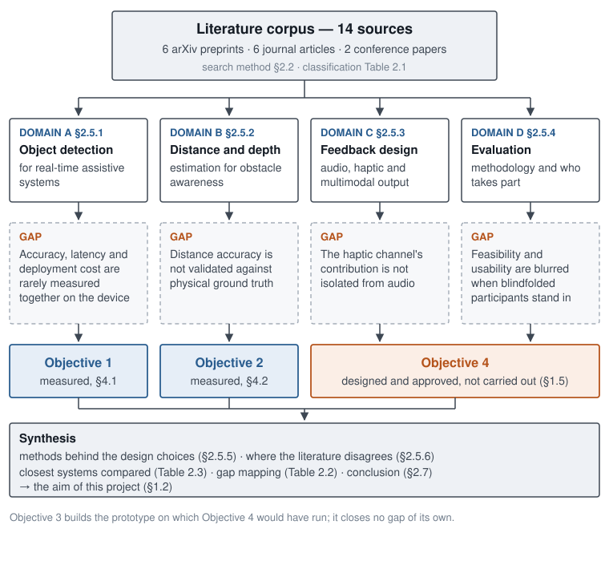

# Chapter 2 — Literature Review

## 2.1 Introduction

This chapter reviews the literature relevant to a smartphone application for
detecting and describing obstacles around blind and visually impaired (BVI)
users in indoor environments. Rather than presenting studies in sequence, the
review is organised into a domain framework derived from the objectives of this
project, which allows the state of the art to be assessed specifically against
the gaps the project sets out to close.

Section 2.2 sets out the method by which literature was identified and
selected. Section 2.3 traces the chronology of the field. Section 2.4
characterises the publication types in the resulting corpus. Section 2.5
contains the main review, divided into four domains: object detection, distance
and depth estimation, multimodal interface design, and evaluation methodology.
It then reviews the methodological literature behind this project's own design
choices (§2.5.5) and the points on which the literature disagrees (§2.5.6).
Section 2.6 compares the closest systems with this one and synthesises the
review into a gap mapping. Section 2.7 concludes by connecting those gaps to
the aim of this project, as Figure 2.1 shows.

One terminological point requires emphasis at the outset. The literature
reviewed here overwhelmingly describes its systems as "navigation" tools. The
scope of this project, as set out in Chapter 1, is narrower: indoor obstacle
awareness only, with no path-following or wayfinding. Where a reviewed system's
claims rest on navigation capability, that difference in scope is noted rather
than elided.

## 2.2 Review methodology

Sources were identified through a combination of academic search engines
(principally Google Scholar) and preprint and publisher databases (arXiv, IEEE
Xplore, the ACM Digital Library, SpringerLink and ScienceDirect). The inclusion
of preprint servers reflects the applied and fast-moving character of the
field, in which peer-reviewed publication typically lags the state of the art.

The initial keyword list was derived directly from the project objectives, and
terms were combined across domains — "YOLO" with "visually impaired", "haptic
feedback" with "navigation" — so that results fell at the intersection of
computer vision and assistive technology rather than within either field alone.
The keywords used were: *assistive navigation*; *visually impaired object
detection*; *YOLO obstacle detection*; *monocular depth estimation mobile*;
*haptic feedback navigation*; *smart cane*; *usability blind visually impaired*.

Searches were restricted where possible to work published from 2019 onward,
consistent with the period in which YOLO-family detectors and mobile deep
learning became practical to deploy on smartphone hardware. Earlier
sensor-only work is cited only where it establishes the baseline against which
the field advanced. Snowball sampling was then applied: the reference lists of
the most directly relevant papers — Khilnani and Devesh (2025), Okolo et al.
(2025), and the state-of-the-art survey by Crivello et al. (2026) — were
screened for further work meeting the same criteria.

Inclusion required that a paper address at least one of the project's three
technical components (detection, distance estimation, feedback) and target a
smartphone or wearable form factor. Work on autonomous vehicles and industrial
robotics was excluded, since those platforms operate under materially different
cost, power and latency constraints.

The resulting corpus comprises **fourteen papers**, spanning preprints,
peer-reviewed journals and conference proceedings. A fifteenth source, Nanath
and Pillai (2014), is cited in §2.1 for its review structure and is not part of
the corpus. Table 2.1 classifies the corpus by primary domain and publication
type.

Domain here is each paper's *primary* contribution, and a few inform more than
one. Chaudary et al. (2023) is classified under feedback design because that is
what the system contributes, while §2.5.4 draws separately on its evaluation
method; the classification records where a paper's contribution sits, not the
only section entitled to cite it.

Table: Table 2.1: Papers reviewed, by primary domain and publication type

| Paper | Primary domain | Publication type |
|---|---|---|
| Anjom et al. (2025) | B — Distance/Depth Estimation | arXiv preprint |
| Chaudary et al. (2023) | C — Feedback Design | Journal (*Virtual Reality*) |
| Crivello et al. (2026) | D — Evaluation Methodology | Journal (*Int. J. Human–Computer Interaction*) |
| Das et al. (2025) | B — Distance/Depth Estimation | arXiv preprint |
| Dede and Gumus (2025) | C — Feedback Design | Journal (*J. Multimodal User Interfaces*) |
| He and Saha (2023) | A — Object Detection | arXiv preprint |
| Khilnani and Devesh (2025) | B — Distance/Depth Estimation | arXiv preprint |
| Kuriakose, Shrestha and Sandnes (2023) | B — Distance/Depth Estimation | Journal (*Expert Systems with Applications*) |
| Lokhande (2024) | A — Object Detection | Journal (*IJISAE*) |
| Okolo et al. (2025) | A — Object Detection | Journal (*Journal of Disability Research*) |
| Rashmi, Guru and Anusuya (2024) | A — Object Detection | arXiv preprint |
| Sridhar et al. (2025) | C — Feedback Design | Conference (ACM SIGACCESS ASSETS) |
| Tokmurziyev et al. (2025) | A — Object Detection | arXiv preprint |
| Zhao and Zhang (2023) | A — Object Detection | Conference (ISIA '23) |

### 2.2.1 What kind of review this is, and what follows from that

This is a **purposive review organised by domain**, not a systematic review. It
reports the databases searched, the keyword strategy, the date restriction, the
snowball step and the inclusion and exclusion criteria, so the selection is
traceable in principle. It does **not** report a PRISMA-style flow: no tally of
records identified, screened, excluded and retained, and no per-database search
dates.

That distinction is stated rather than glossed, because it bounds what the
chapter can claim. A systematic review's value rests on the claim that its
corpus is exhaustive within stated limits, and that claim is only as good as the
screening record that supports it. This review makes no such claim. Its corpus
of fourteen papers is a reasoned selection at the intersection of two fields,
assembled to establish where the gaps in §2.5 lie — which is a defensible basis
for identifying gaps and an inadequate one for asserting that no
counter-example exists. Where the chapter says a practice is rare in the
literature, that should be read as *rare across this corpus and the survey by
Crivello et al. (2026) it draws on*, not as a census.

Two consequences carry into the rest of the thesis. Claims of absence are
framed against the reviewed corpus throughout rather than against the field as a
whole. And the review is reproducible only in the weaker sense that another
reader following the same strategy would find broadly similar work, not the
identical fourteen papers — recorded again in §5.5 among the limitations.

Every quantitative figure this chapter carries from the earlier literature
review was checked against its source on 15 September 2026. Of the seven, six
were confirmed, three of them with their descriptions corrected in the text,
and one could not be verified and was removed; the record is Appendix G.

## 2.3 Research timeline

Research into navigation aids for BVI users predates the deep learning era
considerably. The first electronic travel aids, developed through the 1990s and
early 2000s, attached ultrasonic and infrared sensors to canes or to wearable
harnesses. These devices detected the presence of an obstacle reliably but could
not identify what the obstacle was. Dakopoulos and Bourbakis (2010) survey
twenty-two wearable obstacle-avoidance aids of that generation, which gathered
information with sonar, laser scanners or cameras and conveyed it through sound
or touch. Two points from that survey carry directly into this project: the
guideline it cites that such aids should detect obstacles from ground level to
head height across the full body width, which is the region a cane does not
cover; and its observation that tactile output has the advantage of leaving
hearing free. The inability to identify obstacles defined the field for
roughly two decades, and it still shapes
contemporary low-cost designs, where sensor-only approaches persist as an
inexpensive alternative to vision-based systems (Crivello et al., 2026).

The shift toward vision- and deep-learning-based approaches is comparatively
recent and coincides with the maturation of real-time object detectors.
DeepNAVI (Kuriakose, Shrestha and Sandnes, 2023) demonstrated that a smartphone
could run deep learning on-device to determine an obstacle's identity,
distance, position and motion status without any network connection. From 2023
onward, the use of YOLO detectors in assistive systems expanded rapidly,
tracking the release of more capable variants including YOLOv8 and YOLO-NAS (He
and Saha, 2023; Rashmi, Guru and Anusuya, 2024).

2025 marks a second inflection point, evidenced by a cluster of publications
(Khilnani and Devesh, 2025; Okolo et al., 2025; Sridhar et al., 2025; Dede and
Gumus, 2025; Tokmurziyev et al., 2025; Das et al., 2025; Anjom et al., 2025)
converging on two concerns: pairing detection with distance or depth
estimation, and moving beyond audio-only feedback toward haptic and multimodal
output. Both concerns address the same deficiency in earlier systems — that
detection alone, delivered through a single channel, gives the user too little
to act on. These two themes form the basis of the domain framework in §2.5.

The most recent survey of the field (Crivello et al., 2026), covering 75
systematically selected papers, confirms this trajectory as the current
direction of research while identifying a persistent methodological weakness.
Among the three headline findings the authors report is **a limited focus on
inclusivity factors — usability, accessibility, user experience and co-design**
— alongside an absence of genuinely seamless indoor/outdoor solutions and a gap
between proposed systems and real-world technological readiness. Evaluation
practice, in other words, has not kept pace with technical capability.

## 2.4 Publication types

The corpus of fourteen documents (Table 2.1) comprises six arXiv preprints, six
peer-reviewed journal articles (*Journal of Disability Research*, *Journal on
Multimodal User Interfaces*, *Expert Systems with Applications*, *Virtual
Reality*, *International Journal of Human–Computer Interaction*, and
*International Journal of Intelligent Systems and Applications in
Engineering*), and two peer-reviewed conference papers (ACM SIGACCESS ASSETS,
and ISIA).

The high proportion of preprints relative to more settled disciplines is itself
informative: the field moves quickly enough that peer review has not yet
overtaken the most recent contributions, and several works in this corpus (Das
et al., 2025; Anjom et al., 2025; Tokmurziyev et al., 2025) had not completed
peer review at the time of writing. This is consistent with publication norms
in computer vision and deep learning generally.

This review therefore treats preprint status as acceptable evidence for claims
of timeliness and reported performance characteristics, while requiring
peer-reviewed status for claims about evaluation methodology — on the reasoning
that methodological weaknesses are precisely what peer review is most likely to
surface.

## 2.5 Core review

The corpus is organised into four domains reflecting the project's objectives:
**(A)** object detection for real-time assistive navigation; **(B)** distance
and depth estimation for obstacle awareness; **(C)** multimodal feedback
design; and **(D)** evaluation methodology. Studies spanning more than one
domain are treated in the domain they address most directly and cross-referenced
elsewhere.

### 2.5.1 Domain A — Object detection for real-time assistive navigation

The YOLO family dominates this domain because its single-stage architecture
delivers real-time inference on constrained hardware without the latency
characteristic of two-stage detectors. He and Saha (2023) evaluate seven YOLO
architectures for outdoor obstacle detection and find YOLOv8 to offer the best
precision–recall trade-off on their dataset; this comparison is the closest
existing analogue to Objective 1 of this project, though conducted outdoors.
Rashmi, Guru and Anusuya (2024) extend the approach to indoor small-object
detection using YOLO-NAS Small trained with Super Gradients, addressing the
predominantly outdoor character of existing benchmarks — a deficiency this
indoor-focused project inherits and must also address.

Zhao and Zhang (2023) report 96.3 % recognition accuracy at 8 frames per second (fps) within an 8 m range using a PP-YOLO-based algorithm for outdoor travel assistance —
traffic signs, obstacles and tactile paving. Two further figures from the same
work are more instructive than the headline.

Accuracy falls to **85 % at complex intersections 30 m wide**. That is commonly
read as evidence that performance degrades with scene complexity, and it partly
is — but 30 m is nearly four times the 8 m range at which the 96.3 % was
established. The drop therefore conflates two distinct effects, scene
complexity and operation beyond the validated range, and cannot cleanly
evidence either. This is a caution about how such comparisons are constructed
rather than a criticism of the result.

The cleaner manipulation in that paper holds range constant and varies
lighting: **94 % in low-light conditions within the same 8 m range**, against
96.3 % otherwise. A controlled degradation of roughly two percentage points is
a far more useful figure than an uncontrolled one of eleven, and it is directly
comparable to the bright/dim lighting conditions used in this project's own
capture protocol (§3.7.1).

The principal methodological limitation across this domain is that comparative
evaluations tend to optimise for either speed or accuracy while treating
deployment cost separately, or omitting it altogether. Lokhande (2024)
approaches the problem from an edge-computing perspective, reporting that int8
quantisation reduces inference latency at a modest accuracy cost.

Two qualifications attach to that citation. The venue, the *International
Journal of Intelligent Systems and Applications in Engineering*, has been
delisted from Scopus, so the specific magnitude reported there is not relied on
here; recent benchmarks of int8 post-training quantisation for detection on
edge hardware report reductions varying widely with platform and baseline
precision, which is the more defensible general claim. And quantisation is not
a lever this project pulls — the Core ML exports in §3.5.2 are float — so the
point is included as context on the deployment-cost axis rather than as a
method adopted.

Okolo et al. (2025) is the closest system to this project in scope and is
therefore treated throughout as the primary point of comparison. It combines
YOLOv8 with ultrasonic distance sensing and delivers audio and tactile
feedback, reporting 91.70 % average detection accuracy across nine obstacle
types.

Three characteristics of that figure bear directly on how it should be read.
First, the platform is a **Raspberry Pi 4 smart stick** carrying camera,
ultrasonic, moisture and inertial sensors, a vibration module and a speaker,
alongside a separate Android application for GPS guidance — not a smartphone
with a sensor attached. Second, the nine obstacles are categories of COCO, the Common Objects in Context
dataset (Lin et al., 2014) —
person, car, bus, truck, chair, television, couch, bottle and refrigerator —
of which three are outdoor vehicles and **none is a door, step, stair or
pole**. The system therefore demonstrates the class-coverage limitation set out
in §3.3.1 rather than escaping it. Third, 91.70 % is a mean of per-object
detection accuracies, **not** mean average precision (mAP), the standard
measure for detectors, and must not be placed alongside the
mAP50-95 figures reported in Chapter 4. Finally, Tokmurziyev et al. (2025) illustrate an emerging direction,
combining YOLO-World detection with GPT-4o scene reasoning in their LLM-Glasses
system — indicative of growing interest in coupling detectors with large
multimodal models.

### 2.5.2 Domain B — Distance and depth estimation for obstacle awareness

Detection without distance is of limited practical value: knowing that an
object is present matters far less than knowing whether it is one metre away or
ten. Khilnani and Devesh (2025) build on precisely this premise, combining
obstacle detection with distance estimation in a smart cane so that obstacles
can be prioritised by urgency rather than merely enumerated, reporting
**53.4 % mAP and 71.7 % AP50** (average precision at an overlap threshold of
0.5) using an RT-DETRv3-R50 framework. Both figures
are given here deliberately: AP50 is the more favourable of the two, and the
stricter mAP is the figure comparable to the mAP50-95 reported in Chapter 4,
though even that comparison spans different corpora and should not be read as
like-for-like. This argument for prioritisation is
the direct basis of Objective 2 and of the hazard-weighting scheme in §3.3.4.

Two broad approaches recur. Sensor-assisted methods use ultrasonic or infrared
rangefinders (Okolo et al., 2025). Camera-only methods estimate depth from the
image alone, and are more common in practice because they require no additional
equipment — though at a cost in accuracy. Anjom et al. (2025) develop an
embedded alert system pairing object detection with a depth-estimation model,
quantising both to meet the resource budget. Das et al. (2025) present
PathFinder, an offline, mapless smartphone system using monocular depth to
identify obstacle-free paths, reporting reduced mean absolute error and faster
decision-making than comparable approaches, validated in a usability study with
15 BVI users.

The gap running through this domain is the nature of the validation. Distance
estimates are characteristically evaluated against annotated datasets or
against the system's own internal benchmark, rather than against distances
measured independently and physically. In the closest comparable system the
omission is starker still: Okolo et al. (2025) report distance accuracy as a
**boolean** — their results table records `True` against all nine objects, with
no error magnitude, no units and no ground truth. The system's distance
estimates are reported as correct rather than measured as accurate. A dataset's depth annotations are
themselves sensor-derived and carry their own error; validating one sensor
estimate against another does not establish accuracy in the sense a user would
care about. Objective 2 addresses this directly by placing obstacles at
tape-measured distances and reporting error against those measurements.

### 2.5.3 Domain C — Multimodal feedback design

The majority of deployed systems convey information through audio alone. Audio
is straightforward to implement, but it performs poorly in noisy environments
and — more importantly — it occupies a sensory channel that BVI users already
rely on heavily for spatial awareness. Several recent systems therefore
investigate haptic output as an alternative or supplement.

Dede and Gumus (2025) present Vis-Assist, a wearable device that encodes object
identity in vibration patterns, reporting that users could distinguish 19
object categories after a short familiarisation period. This is a substantive
result: it demonstrates that the haptic channel can carry categorical
information, not merely a proximity alarm. Tokmurziyev et al. (2025) report an average
recognition rate of 81.3 % across **thirteen distinct haptic patterns**
delivered to the temples in their LLM-Glasses system — lower than audio would
achieve, but across a vocabulary large enough to establish that haptic encoding
can carry considerably more than a binary warning.

Okolo et al. (2025) combine audio and haptic feedback within a single system,
but do not isolate the contribution of the haptic channel from that of audio.
Their evaluation establishes that the combined system works; it does not
establish that the haptic component contributes to that result. Closing this
gap was the purpose of Objective 4, which was designed as a controlled
comparison of audio-only against audio-plus-haptic conditions. **That
evaluation was not conducted (see §1.5), and this gap therefore remains open at
the close of this thesis.**

Chaudary et al. (2023) study teleguidance-based remote navigation assistance
and find that BVI participants' preferences among haptic guidance modes varied
with their prior familiarity and cane experience — indicating that haptic
feedback design is sensitive to user background even with simple hardware, and
that a single encoding scheme is unlikely to suit all users.

A caveat applies to one line of argument in this domain. Systems offering
richer capability frequently require hardware beyond a standard phone — Sridhar
et al.'s (2025) NaviSense, for example, depends on depth-sensing and
augmented-reality capability. It would be inconsistent for this project to
treat that as a straightforward limitation, because the prototype developed
here also uses a depth sensor: ARKit's `sceneDepth`, backed by the LiDAR
scanner in the iPhone Pro line. The relevant distinction is not
sensor-versus-no-sensor but **integrated versus additional**: a LiDAR scanner
built into a consumer handset the user already owns imposes no additional
device, cost or setup burden, whereas an external unit or headset does.
Objective 2 is designed with exactly this distinction in mind, comparing the
built-in depth sensor against a monocular network that requires no sensor at
all, so that the trade-off between accuracy and device coverage is measured
rather than assumed.

### 2.5.4 Domain D — Evaluation methodology for assistive navigation systems

Evaluation practice across this literature is inconsistent. Crivello et al.
(2026), surveying 75 systematically selected papers, identify limited attention
to usability, accessibility, user experience and co-design as one of three
headline weaknesses in the field. Many systems report technical performance
only — accuracy, latency, throughput — without establishing whether the system
is usable by anyone. Technical performance is necessary but not sufficient: a
detector's mAP says nothing about whether a BVI user can act on what the system
communicates.

Among studies that do evaluate usability, methods vary widely. Das et al.
(2025) tested PathFinder with 15 BVI participants, reporting that 73 % learned
the interface in under a minute and 80 % rated its accuracy and responsiveness
favourably. Chaudary et al. (2023) combined the meCUE 2.0 questionnaire with
interviews and focus groups involving 11 BVI participants and one sighted
carer, illustrating how quantitative instruments and qualitative methods can be
combined. Dede and Gumus (2025) evaluated Vis-Assist across two
experiment types with four participants, using task completion time — a
reasonable measure, but one whose interpretation is sharply limited by the
sample size. Small participant counts are common in
this field and constrain what can be concluded from any individual study.

A further and more consequential inconsistency concerns participant
recruitment. Where BVI participants are unavailable, or where time and approval
constraints intervene, blindfolded sighted participants are frequently
substituted. Crivello et al. (2026) document both practices without
adjudicating between them. The substitution is methodologically defensible for
establishing **technical feasibility** — that the system functions, that the
feedback is perceptible, that the task can be completed at all. It does not
establish **usability** for BVI users, whose spatial strategies, hazard
assessment and cane technique differ substantially from those of a sighted
person who has been blindfolded for an hour.

That distinction is frequently blurred in reporting. A result obtained with
blindfolded sighted participants is presented as evidence about a system for
BVI users, without the qualification that separates the two.

This project was designed to observe that distinction explicitly: Objective 4
would have used blindfolded sighted participants and would have been reported
as a feasibility demonstration only. **As recorded in §1.5, Objective 4 was not
carried out.** No participant data of any kind was collected, and no claim in
this thesis rests on participant evidence. The distinction between feasibility
and usability is therefore maintained in the strongest available form — by
having no participant claims to qualify.

### 2.5.5 The methods behind this project's design choices

The four domains above describe what assistive systems do. The choices made in
this project also rest on a methodological literature outside the assistive
corpus, and that literature is reviewed here so that each choice in Chapter 3
has a stated basis.

**Detector architecture.** Object detectors divide broadly into two-stage
designs, in which a region-proposal network nominates candidate boxes that a
second stage classifies (Ren et al., 2017), and single-stage designs that
predict boxes and classes in one pass over the image, introduced by the YOLO
family (Redmon et al., 2016). Two-stage detectors were historically the more
accurate and single-stage detectors the faster, which is why the systems in
Domain A are overwhelmingly YOLO-based. Transformer detectors have since
contested that division: RT-DETR reports outperforming contemporary YOLO models
in both speed and accuracy on a server-class graphics processor (GPU) (Zhao et al., 2024), and it is
the detector Khilnani and Devesh (2025) use. The YOLO line has meanwhile
removed non-maximum suppression, the post-processing step that discards
duplicate boxes, by predicting a non-redundant set of boxes directly; its
developers and independent reviewers present this as removing a latency
bottleneck in deployment (Sapkota et al., 2025; Jocher et al., 2026). None of
these comparisons was made on a phone, which is the gap Objective 1 fills.

**Monocular depth.** Estimating absolute depth from one image is ill-posed, and
the influential work on robust monocular depth trained across many datasets
with a loss that ignores scale and shift, producing relative rather than metric
depth (Ranftl et al., 2022). A relative map cannot be compared with a tape
measure without fitting a scale to each image, and fitting that scale uses the
ground truth being tested against. Depth-Anything-V2 (Yang et al., 2024) is
trained on synthetic images and on large quantities of pseudo-labelled real
images, and its authors release metric variants fine-tuned for indoor scenes on
Hypersim, a photorealistic synthetic indoor dataset (Roberts et al., 2021).
Metric prediction from a single image carries a further ambiguity. Yin et al.
(2023) show that metric depth models trained on one camera model do not
transfer their scale to cameras with other intrinsics without an explicit
correction. That point matters again in §5.3.

**Consumer LiDAR.** Luetzenburg, Kroon and Bjørk (2021) evaluated the LiDAR
sensor of the iPhone 12 Pro for geoscientific surveying and report an absolute
accuracy of about ±1 cm on objects larger than 10 cm. That figure comes from
scanning, in which many frames are accumulated into one model, not from
reading a single frame's depth map from a hand-held phone, so it is a best case
rather than a prediction for this use.

**Feedback design.** Blattner, Sumikawa and Greenberg (1989) define earcons as
brief non-speech audio messages built from short motives of pitch and rhythm and
grouped into families of related sounds. Brewster and Brown (2004) carry the
idea to touch with tactons, structured tactile messages that vary the
frequency, amplitude, duration and rhythm of a pulse. Together they supply the
vocabulary of §3.8.3: a small family of earcons differing in pitch and cadence,
and a vibration whose intensity, sharpness and pulse rate encode how urgent an
obstacle is.

**Who takes part in an evaluation.** Sears and Hanson (2012) argue that
non-representative participants can be acceptable for preliminary evaluations,
but that studies making archival claims should include representative users,
even where the two groups might be expected to behave alike. That is the
principle behind the feasibility–usability distinction held throughout this
thesis, and it is stated in the accessibility literature itself rather than
invented for this project.

### 2.5.6 Where the literature disagrees

Three disagreements in the corpus bear directly on this project, and a fourth
concerns how systems should be evaluated.

**Sensor or camera for distance.** Recent systems split into those that add a
range sensor, such as the ultrasonic unit of Okolo et al. (2025), the depth
camera of Khilnani and Devesh (2025) and the LiDAR of NaviSense (Sridhar et al.,
2025), and those that estimate depth from a single camera (Das et al., 2025;
Anjom et al., 2025). The camera-only systems justify themselves on hardware
cost and reach; the sensor systems on accuracy. Neither side reports distance
error against a physical measurement, so the corpus cannot settle what the
accuracy cost of going camera-only actually is. Objective 2 measures it.

**Whether haptic output adds anything.** The corpus agrees that the haptic
channel can carry information: nineteen object categories in Vis-Assist (Dede
and Gumus, 2025) and thirteen patterns at 81.3 % recognition in LLM-Glasses
(Tokmurziyev et al., 2025). It does not agree on what users want from it, since
Chaudary et al. (2023) found preferences varying with background, and no
reviewed study isolates whether adding haptics to audio improves a user's
response. The disagreement is therefore partly an absence of evidence, which
Objective 4 was designed to supply.

**Which detector family suits a mobility aid.** Most systems use YOLO
detectors, while the transformer-based RT-DETR claims to have overtaken them
(Zhao et al., 2024). Those claims are made on server GPUs. The one reviewed
system using the transformer family reports end-to-end latency of about 150 ms
per frame (Khilnani and Devesh, 2025), several times the 33 ms between frames
of a 30 Hz camera, which suggests that the server-GPU comparison does not carry
over to wearable hardware without being measured there.

**Who should evaluate a system.** Crivello et al. (2026) document both
blindfolded sighted participants and BVI participants in the surveyed work
without adjudicating between them, while Sears and Hanson (2012) argue that
only representative users support claims about the target population. This
thesis takes the second position (§2.5.4).

## 2.6 Output of the review

The review has two outputs: a mapping between the four domains and the
specific gaps this project's objectives were designed to close (Table 2.2), and
a comparison of the closest systems with this one (Table 2.3).

Table: Table 2.2: Domain-to-objective gap mapping

| Domain | Dominant approach in the literature | Identified gap | Addressed by |
|---|---|---|---|
| A. Object detection | YOLO variants optimised largely for outdoor scenes; accuracy and speed reported separately from deployment cost | Few studies jointly benchmark accuracy, latency and cost for indoor, mobile-only deployment | **Objective 1** |
| B. Distance/depth estimation | Sensor-assisted or monocular depth, validated mainly against annotated datasets or internal benchmarks | Few studies validate distance accuracy against independently measured physical ground truth | **Objective 2** |
| C. Feedback design | Predominantly audio-only; haptic treated either as a full substitute or as an untested addition | Contribution of the haptic channel rarely isolated from audio in a controlled comparison | **Objective 4** — designed, not carried out (§1.5) |
| D. Evaluation methodology | Limited attention to usability, accessibility and user experience across 75 surveyed systems (Crivello et al., 2026); blindfolded-participant results often reported without distinguishing feasibility from usability | Systematic proof-of-concept testing that states that distinction explicitly is the exception rather than the norm | **Objective 4** — designed, not carried out (§1.5) |

Table: Table 2.3: The closest reviewed systems compared with this project. A dash means the item is not stated in the abstract or in the parts of the paper consulted for this review; BLV means blind and low vision.

| System | Platform | Detection | Distance source | Distance validated against | Feedback | Evaluation with people |
|---|---|---|---|---|---|---|
| Okolo et al. (2025) | Raspberry Pi 4 smart stick with a separate Android app | YOLOv8, nine COCO classes | ultrasonic sensor | reported as correct or incorrect, with no error magnitude | audio and vibration | — |
| Kuriakose, Shrestha and Sandnes (2023), DeepNAVI | smartphone | lightweight deep-learning models | estimated on the phone | — | audio | — |
| Das et al. (2025), PathFinder | smartphone | obstacle-free path from monocular depth | monocular depth | relative comparison with other methods | — | 15 BLV participants |
| Khilnani and Devesh (2025) | smart cane | RT-DETRv3-R50 | depth camera | — | haptic and audio | — |
| Anjom et al. (2025) | embedded system | quantised detector | monocular depth | — | alert (channel not stated) | — |
| Dede and Gumus (2025), Vis-Assist | wearable | on-device detection, 19 classes | measured on the device | — | vibration motor array | 4 participants |
| Tokmurziyev et al. (2025), LLM-Glasses | glasses | YOLO-World with GPT-4o reasoning | — | — | haptic, at the temples | three studies |
| Sridhar et al. (2025), NaviSense | mobile app using LiDAR and augmented reality | open-vocabulary vision-language model | LiDAR | — | audio and haptic | 12 BLV participants |
| **This project** | smartphone with built-in LiDAR | YOLOv8n, YOLO11n, YOLO26n, fine-tuned and compared | LiDAR compared with a monocular network | **tape measure, 102 frames, 0.5–4.5 m** | graded haptic and panned audio, switchable | none; designed, approved and not run |

Two patterns stand out in Table 2.3. The column for distance validation is
almost empty, which is the gap Objective 2 addresses; the two systems that
report anything report correctness or a relative comparison, not an error in
metres. And the systems that did run user studies (PathFinder, Vis-Assist,
NaviSense) do not report distance error against a physical measurement, while
those focused on sensing did not run user studies. No reviewed system does
both, and this project does not either: it measures the sensing and leaves the
user study as further work.

Okolo et al. (2025) remains the closest point of comparison. That system pairs
a YOLO detector with sensor-based distance estimation and delivers audio and
tactile feedback, reporting 91.70 % average detection accuracy. Three
characteristics distinguish it from the work undertaken here: it requires an
external ultrasonic unit rather than relying on hardware already present in a
consumer handset; it does not compare alternative detection or
distance-estimation methods against one another; and it does not validate its
distance estimates against independently measured physical ground truth.

The contribution of this project is therefore not the concept of combining
detection, distance estimation and feedback — Okolo et al. (2025) and others
have established that this combination is workable. It lies in the specifics,
and the order matters:

1. **Validating distance estimation against independently measured physical
   ground truth**, using obstacles placed at tape-measured distances, which the
   reviewed corpus does not do.
2. **Benchmarking detection accuracy, latency and deployment cost jointly**
   rather than separately, with every latency figure measured on the target
   device.
3. **Isolating the contribution of the haptic channel** from audio in a
   controlled comparison — designed, approved, and not carried out (§1.5).
4. **Separating feasibility from usability explicitly** in both method and
   claims.

Operating on smartphone hardware alone is deliberately *not* listed as a
contribution. DeepNAVI (Kuriakose, Shrestha and Sandnes, 2023) and PathFinder
(Das et al., 2025) are both smartphone-only systems and both predate this work;
claiming novelty on that basis would misrepresent the corpus reviewed in this
very chapter.

## 2.7 Conclusion

This chapter reviewed research across four domains relevant to smartphone-based
indoor obstacle awareness for BVI users: object detection, distance and depth
estimation, multimodal feedback design, and evaluation methodology. The field
has developed rapidly since 2023, converging on YOLO-based detection paired
with some form of distance estimation and, increasingly, haptic feedback
alongside audio.

Four gaps recur across the corpus (Table 2.2). Distance-estimation accuracy is
rarely tested against a physical ground truth. Detection accuracy, latency and
deployment cost are reported separately, and not measured on the target
device. The haptic channel's contribution is not isolated from audio. And the
distinction between a proof-of-concept demonstration and usability evidence is
often left implicit, particularly where blindfolded sighted participants stand
in for BVI users.

These gaps lead directly to the aim set out in §1.2. The first two define the
measurements this project makes (Objectives 1 and 2). The third defines the
evaluation it designed but did not run (Objective 4). The fourth is held as a
constraint on every claim. The methodological literature in §2.5.5 then
supports the specific choices made in Chapter 3: a YOLO-family nano comparison
measured on the phone, a metric rather than relative depth network compared
against the built-in LiDAR, earcon and tacton principles for the feedback, and
a clear line between feasibility and usability.
