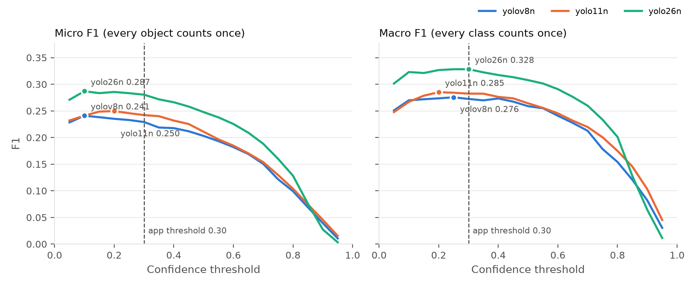

# Chapter 4 — Results and Findings

## 4.1 Objective 1 — detector comparison (RQ1)

### 4.1.1 Detection accuracy

Three detectors were fine-tuned under identical hyperparameters (Table 3.9)
and each was trained twice, so that the ranking could be distinguished from
run-to-run variation (§3.5.1). Table 4.1 reports AP50-95 per class for both
runs. mAP50-95 runs from 0 to 1, where 1 would mean that every annotated object
is found, with a box overlapping it closely at every threshold from 0.50 to
0.95, before any false detection. A pooled value of 0.17 is therefore low but
not meaningless, and because the measure is strict and averages over every
confidence threshold, §4.1.7 translates it into the errors the prototype
actually makes at its own threshold.

Table: Table 4.1: Per-class AP50-95 for each detector, both training runs

| class | yolov8n r1 | yolov8n r2 | yolo11n r1 | yolo11n r2 | yolo26n r1 | yolo26n r2 |
|---|---|---|---|---|---|---|
| person | 0.039 | 0.047 | 0.036 | 0.028 | 0.039 | 0.048 |
| chair | 0.028 | 0.021 | 0.028 | 0.032 | 0.047 | 0.047 |
| table | 0.077 | 0.100 | 0.059 | 0.081 | 0.124 | 0.126 |
| door | 0.063 | 0.089 | 0.072 | 0.085 | 0.125 | 0.134 |
| window | 0.055 | 0.045 | 0.040 | 0.041 | 0.061 | 0.049 |
| stairs | 0.212 | 0.169 | 0.169 | 0.242 | 0.242 | 0.258 |
| wall | 0.366 | 0.418 | 0.452 | 0.343 | 0.455 | 0.488 |
| low_obstacle | 0.106 | 0.115 | 0.151 | 0.144 | 0.222 | 0.206 |
| **pooled mAP50-95** | 0.118 | 0.125 | 0.126 | 0.125 | **0.164** | **0.170** |

YOLO26n achieves the highest pooled mAP50-95 in both runs and wins most
individual classes in both. The two runs share a seed (§3.5.1), so their
agreement shows that the ranking survives run-to-run variation, not that it
survives a different initialisation; §4.1.7 tests the same ranking against
resampling of the validation scenes.

Three qualifications belong with these numbers.

**Run-to-run variance is small pooled but large per class.** Pooled mAP moves by
at most 0.007 between runs for any model, but individual classes move far more —
YOLO11n's `stairs` went 0.169 → 0.242 and its `wall` 0.452 → 0.343. Per-class
figures from a single run should be read as noisy; claims resting on a single
class should quote a range across runs, not one value.

**Absolute accuracy is low across all three models** (pooled mAP50-95
0.12–0.17). Several explanations are plausible and are not distinguished by this
experiment: only about 900 distinct source photographs sit behind the 2,714
augmented training images, training ran for only 50 epochs, and the annotation
quality of the source corpus had not at this point been audited (§4.1.8 does
so). This should not be read as evidence that the pipeline is broken, nor as
evidence that it is sound.

**`person` and `chair` are consistently the two weakest classes**, trading last
place between runs — `chair` is weakest in four of six model-run combinations
and `person` in two. This is notable because `person` is usually an easy class
elsewhere, and it points at annotation quality in the source corpus as worth a
manual check.

### 4.1.2 On-device latency and deployment cost

Latency was measured on the iPhone 13 Pro Max across runs of 15 minutes or
longer: yolov8n for 1,423.5 s (42,675 frames), yolo11n for 771.7 s (23,143
frames), yolo26n for 794.9 s (23,842 frames). Table 4.2 combines those
measurements with accuracy and deployment cost.

Table: Table 4.2: Accuracy, on-device latency and deployment cost (run 2 accuracy; latency in milliseconds per frame, end to end)

| model | mAP50-95 | params | `.mlpackage` | cold (ms) | sustained (ms) | p95 (ms) | fps | licence |
|---|---|---|---|---|---|---|---|---|
| yolov8n | 0.1254 | 3,013,188 | 6.2 MB | 12.68 | 12.65 | 13.69 | 79.1 | AGPL-3.0 |
| yolo11n | 0.1247 | 2,592,180 | 5.4 MB | 13.04 | 12.87 | 13.93 | 77.7 | AGPL-3.0 |
| **yolo26n** | **0.1696** | **2,508,480** | **5.0 MB** | 13.07 | **12.65** | 13.75 | 79.0 | AGPL-3.0 |

### 4.1.3 Finding: YOLO26n dominates rather than trades off

YOLO26n returns the best accuracy (35 % higher pooled mAP50-95 than either
alternative), the fewest parameters, the smallest deployment footprint, and
sustained latency tied for fastest. The expected speed-versus-accuracy
trade-off does not appear on this benchmark — one model is better on every
axis measured. Given the caveats in §4.1.1, the claim is scoped to this corpus
and these three nano-scale variants.

### 4.1.4 Finding: no thermal throttling was observed

`thermal_state` remained `nominal` throughout all three runs, and latency
drifted by no more than 0.4 ms between the cold and sustained phases. Sustained
camera and Neural Engine load was expected to induce throttling within 10–15
minutes; it did not, under these conditions.

The instrumentation is confirmed working rather than silently failing: the
thermal field is populated, and the cold/warm/sustained transitions occur
exactly at the designed 60 s and 300 s marks. The two observations agree with
each other — no throttling and no latency drift — rather than one contradicting
the other.

The scope of this result is bounded by what was not controlled. The phone was
in open air at an unrecorded ambient temperature. The finding is that these
nano-scale detectors do not throttle an A15 under these conditions, not that
thermal limits are irrelevant to the design.

### 4.1.5 Finding: buffer handling costs nearly as much as inference

Averaged across all three models, `capture` (YpCbCr → BGRA conversion) plus
`preprocess` (letterbox resize) together cost 5.4–5.6 ms per frame, against
7.2–7.4 ms for Core ML inference itself. Non-inference buffer handling is
therefore roughly **43 % of total pipeline latency**.

This is the reason the pipeline converts pixel buffers explicitly instead of
delegating to the Vision framework. Reporting `detect_ms` alone as "pipeline
latency" would have understated the real cost by close to half, and the
understatement would have been invisible.

All three models sustain more than 75 fps end to end. Latency is not what
separates these variants; accuracy is.

### 4.1.6 A threshold that does not exist

No pass/fail latency threshold for a walking user appears anywhere in the
reviewed literature. The benchmark therefore reports the raw distribution and
grades nothing against a criterion. Inventing a threshold retrospectively to
declare these figures adequate would be unfounded, and is not done. Sourcing a
defensible figure is identified as further work in Chapter 6.

### 4.1.7 At the operating threshold: confusion matrix, precision, recall and F1

The evaluation in §3.5.3 fixes the confidence threshold where the prototype
fixes it, at 0.30. Its first step reproduced the Colab AP figures of §4.1.1
exactly, so what follows is the same evaluation seen at one operating point.

Table 4.3 reports the operating-point metrics for all three models.

Table: Table 4.3: Operating-point metrics on the validation split (2,435 objects), confidence > 0.30, IoU > 0.5

| metric | yolov8n | yolo11n | **yolo26n** |
|---|---|---|---|
| precision (micro) | 0.385 | 0.408 | **0.438** |
| recall (micro) | 0.163 | 0.172 | **0.206** |
| **F1 (micro)** | 0.229 | 0.242 | **0.280** |
| F1 (macro, 8 classes) | 0.272 | 0.283 | **0.328** |
| matrix accuracy | 0.133 | 0.142 | **0.166** |
| classification accuracy | 0.839 | 0.835 | **0.890** |
| recall at any threshold (conf > 0.001) | 0.394 | 0.384 | **0.408** |

**The errors are misses, not confusions.** Of the 2,435 annotated objects,
YOLO26n boxes 564. It names 502 of those correctly, a classification accuracy
of 89 %. It never boxes the other 1,871, which is 77 % of all objects. The
off-diagonal of Figure 4.1 is sparse, and its largest entries pair classes that
genuinely resemble one another: window as door (10), chair as table (9), person
as low obstacle (8). The largest share of any one class is door as window, 6 of
113 doors. The
same pattern holds for all three models, with classification accuracy of 84–89 %
against recall of 16–21 %. What keeps F1 low is objects the detector does not
find at all, not objects it finds and misnames.

**No threshold recovers them.** Counting every box the model emits at all, with
confidence above 0.001, YOLO26n still finds only 41 % of objects with the
correct class. The remaining 59 % are unreachable by any choice of threshold.

**The prototype's threshold is well placed.** YOLO26n's micro F1 varies by less
than 0.01 between thresholds of 0.10 and 0.30 (Figure 4.2), and its macro F1
peaks at exactly 0.30. Moving the threshold trades precision against recall
without improving their balance, so 0.30 is kept. It was not tuned on this data
and this is a check, not a selection.

**The ranking holds at the operating point, and it is larger than resampling
noise.** In a paired bootstrap over validation scenes (§3.5.3), YOLO26n's micro
F1 exceeds YOLOv8n's by 0.051 (95 % interval 0.024 to 0.081) and YOLO11n's by
0.039 (0.008 to 0.070). Macro F1 gives the same result. Neither interval
includes zero. YOLOv8n and YOLO11n cannot be separated: 0.013, −0.015 to 0.039.
This is the operating-point counterpart of the mAP ranking in §4.1.1, and it
agrees with it.

On the 84 unaugmented scenes alone, 282 objects, YOLO26n still has the highest
micro F1 (0.288, against 0.279 and 0.247), but YOLO11n has the highest macro F1
(0.341, against 0.292 for YOLO26n). Every paired interval on this subset spans
zero, including that one (−0.117 to 0.025). The unaugmented subset is too small
to confirm the ranking or to overturn it, and it is reported as neither.

**Recall by object size.** Recall rises steeply with object size: 0.07 for small
objects, 0.14 for medium and 0.36 for large for YOLO26n, with the same gradient
for the other two models. Small objects are a large part of what is missed, but
they do not explain the level: 64 % of large objects are still not correctly
found.
`window`, whose 747 instances are 92 % small or medium, reaches a recall of only
0.14. `person` is the single exception to the gradient: large people are found
less often (0.11, 139 objects) than medium ones (0.25). Every other class with
instances in both bands finds its large ones more easily.

Table 4.4 breaks the YOLO26n figures down by class.

Table: Table 4.4: Per-class results for YOLO26n at confidence > 0.30

| class | objects | precision | recall | F1 | missed | misclassified | spurious |
|---|---|---|---|---|---|---|---|
| wall | 84 | 0.593 | 0.607 | **0.600** | 27 | 6 | 32 |
| low_obstacle | 344 | 0.621 | 0.358 | 0.454 | 211 | 10 | 62 |
| stairs | 83 | 0.545 | 0.361 | 0.435 | 51 | 2 | 22 |
| table | 329 | 0.536 | 0.225 | 0.317 | 249 | 6 | 54 |
| door | 113 | 0.313 | 0.221 | 0.259 | 81 | 7 | 41 |
| window | 747 | 0.374 | 0.141 | 0.204 | 629 | 13 | 167 |
| person | 367 | 0.267 | 0.153 | 0.194 | 302 | 9 | 147 |
| chair | 368 | 0.392 | 0.103 | **0.163** | 321 | 9 | 56 |

The per-class order broadly follows §4.1.1's AP ranking. `wall`, `stairs` and
`low_obstacle` lead, and `chair` and `person` trail. `stairs`, the highest
hazard weight in the taxonomy, is found in 30 of 83 validation photographs at
the operating threshold. That is a per-photograph rate. In live use a staircase
stays in view across many frames, which would raise the chance of detecting it
at least once. The prototype's 3-of-5 confirmation gate would lower it again.
Neither effect was measured, so no per-encounter rate is claimed.

Three limits apply to every figure in this section.

**The precision figures understate the detector, and by a measured amount.** A
**spurious** box is one with no *annotated* object beneath it, which is not the
same as a box with no object beneath it. The corpus's annotation completeness
was audited afterwards (§4.1.8): of the 581 boxes counted spurious here, 180
sit on an object of their own class that was already matched or was boxed a
little too loosely, and in a sample drawn from those overlapping nothing
annotated, 21 of 47 are real objects the annotators did not label — most often
windows, chairs and people. Scored against validation labels completed by an independent
detector, YOLO26n's `person` precision is 0.67 rather than the 0.27 above. The
figures here stand as measured against the ground truth this corpus provides.
They are a lower bound on precision, and §4.1.8 quantifies the gap.

**The figures come from one training run**, and §4.1.1 shows per-class results
moving substantially between runs.

**They describe the source corpus's own photographs.** §4.2.1 shows the
detector transfers poorly to the researcher's own captures, so these numbers
are an in-distribution upper bound, not field performance — which §4.1.8 tests
directly. The full record, including the confusion matrices for the other two
models, is in `results/objective1_confusion_findings.md`.

### 4.1.8 What moves the numbers: retraining experiments

§4.1.7 established where the detector's deficit lies — in finding objects
rather than naming them. This section reports what was tried against it. The
protocol is §3.5.4: YOLO26n held fixed, one change at a time, a local
`baseline` retrain as the comparison point, and four evaluation sets so that no
single benchmark decides.

**The local baseline reproduces the Colab model.** Micro F1 0.281 against
0.280, a paired difference of +0.001 (95 % interval −0.024 to +0.026). The
experiments below are therefore comparable with §4.1.7's figures.

**Training longer was excluded before testing.** In all three Objective 1
checkpoints, validation box loss rises from the first epoch while training loss
falls (YOLO26n 1.64 → 1.90 against 1.64 → 1.07) and validation mAP flattens
near epoch 40. The models overfit a corpus of roughly 900 distinct
photographs. What the model trains **on** was therefore varied, not how long it
trains.

Table 4.5 reports every variant against the local baseline.

Table: Table 4.5: Retraining experiments, each compared with the local baseline

| variant | val micro F1 | val macro F1 | AIB-test micro F1 | completed-val micro F1 | captures |
|---|---|---|---|---|---|
| baseline | 0.281 | 0.334 | 0.134 | 0.252 | 11 / 102 |
| mosaic | **0.326** | 0.377 | 0.196 | 0.291 | 7 / 102 |
| relabel | 0.295 | 0.363 | 0.191 | 0.423 | 8 / 102 |
| COCO added | 0.300 | 0.353 | 0.180 | 0.278 | 8 / 102 |
| AI Builders added | 0.294 | 0.346 | — | 0.263 | **37 / 102** |
| mosaic + relabel | 0.305 | **0.385** | 0.234 | 0.434 | 12 / 102 |
| all three | 0.313 | 0.376 | — | **0.446** | 26 / 102 |

(The two variants trained on AI Builders have no comparable figure on its test
split. The captures column counts frames, of 102, in which the photographed
class is detected at all.)

**Mosaic augmentation is the largest single gain on the benchmarks**: +0.045
micro F1 (0.019 to 0.071) and +0.044 macro F1 on validation, +0.063 on the
out-of-source AI Builders test, and small-object recall from 0.077 to 0.107.
This reverses the decision recorded in §3.4, which excluded mosaic on the
argument that it composes viewpoints a chest-held phone never occupies. That
argument is sound about viewpoints and wrong about outcomes on this corpus.

**The added labels are about four-fifths accurate.** A sample of 48 of them was
checked by eye: 38 correct, 8 wrong, 2 undecidable, with the errors concentrated
in `person` — the class the process added most of. This bounds what follows
rather than undermining it, because the gain below is measured against the
**unchanged** validation labels: a wrong training label cannot make the model
better at finding objects that were annotated all along.

**Completing the missing annotations doubles recall on the two weakest
classes.** Filling in 2,204 unlabelled `person`, `chair` and `table` boxes in
the training split takes `person` recall from 0.155 to 0.341 and `chair` from
0.098 to 0.198, **measured against the original validation labels**, so the
gain is in finding the objects the annotators did label, not an artefact of the
new ones. It also removes the anomaly §4.1.7 reported: large people go from the
hardest size band (recall 0.12) to the easiest (0.47). The suspicion that
annotation quality, not model capacity, held `person` and `chair` down is
therefore tested and supported.

The same rule applied to the validation labels — reported as secondary, since
one detector wrote both sets — added 793 boxes to 678 images, 605 of them
people, against 367 originally labelled. Against those completed labels the
relabelled model's precision **rises**, 0.492 to 0.593, which is the direction
§4.1.7's caveat predicted: the extra boxes counted against it were mostly real
people.

**Adding COCO gives a small gain that does not clear its interval** (+0.020,
−0.005 to 0.047) and doubles training time. The feared side effect, COCO's
unlabelled doors and windows teaching those classes as background, did not
appear.

**Only one change reaches the deployment setting.** On the 102 tape-measured
captures — the sole evaluation taken where the prototype is used — adding the
AI Builders corpus takes the count of frames in which the photographed class is
found from 11 to **37**. The door is found in all 19 of its frames, at every
distance from 0.5 m to 4.5 m, with median confidence 0.84; the chair, which no
other model found even once, in 14 of 19. On validation the same variant is
neutral overall and improves `door` F1 from 0.286 to 0.371.

**But the best benchmark model introduces a hazard-relevant false alarm.** The
combined recipe is the strongest model on every photograph set — completed-val
micro F1 0.446 (+0.194 over baseline), precision 0.602, the highest recall of
any variant — and it keeps the door on the captures. Yet in 20 of the 44 pole
and low-obstacle capture frames its most confident box is a `door` drawn over
**empty tiled floor**. The AI-Builders-only variant does the same in milder
form, labelling such boxes `wall`. In the prototype, a `door` box on the floor
would take its distance from the floor immediately ahead and raise a
close-range warning where there is no door, and `door` carries hazard weight
0.7 against `wall`'s 0.4. The same weakness is visible on validation: the
combined model's `door` F1 is the lowest of any variant, with precision near
0.31 against baseline's 0.40.

**The prototype therefore keeps the model Chapter 4 measures.** The retrained
weights are bundled in the application and selectable beside it, labelled as
experimental, so that the comparison can be repeated in a real corridor; they
are not the default, and no figure in this thesis is produced with them.

Three findings survive this exercise, and the third is the one that
generalises.

1. **Data, not training time or model capacity, is the binding constraint.**
   Every gain came from changing what the model trained on.
2. **Annotation completeness is both a measurement problem and a training
   problem.** It depressed the reported precision and it depressed the model's
   actual recall, and one intervention improved both.
3. **A benchmark cannot certify a detector for a setting it has never seen.**
   The combined model is the best on three photograph benchmarks and would
   have been the obvious choice on any of them. The measurement that caught
   its floor-as-door failure is the only one taken in the environment the
   system is meant to work in. The full record is
   `results/objective1_ablation_findings.md`.

## 4.2 Objective 2 — distance estimation (RQ2)

The tape-measured capture set was collected on 2026-09-16: 121 raw frames,
cleaned to 102 after removing stray smoke-test captures at implausible
distances and twelve practice shots taken while re-learning the capture
workflow, and after relabelling twelve frames where the on-screen distance
field had not been updated before the phone was moved to the next mark
(§3.3.9; full correction log in Appendix E). Bright lighting only: a
dim-condition session was not completed in the time available, and is
reported as not attempted rather than approximated from the bright frames, for
the same reason RQ3 and RQ4 are reported as unanswered rather than guessed at
in §1.5.

### 4.2.1 Detector coverage was the binding constraint, not depth accuracy

Before distance can be evaluated, an object must be detected. The fine-tuned
YOLO26n detector, the winner of §4.1, was run over all 102 frames. It returned
a box in **38 frames (37 %)**, and a box named with the photographed class in
12: eleven door frames and one table edge. `pole` and `low_obstacle` returned no
box of their own class, or of a permitted substitute, in any of their 22 frames
each (Table 4.6).

Because a box of the wrong class can still lie on the right object, and a box
of the right class can lie on the wrong part of it, each of the 38 boxes was
inspected on its frame and the verdicts were confirmed by the researcher
(§3.7.2). Thirty lie on the photographed object: the eleven door boxes named
`door`, and nineteen named otherwise, the chair's slatted backrest read as a
`window` in 13 of the chair frames and the door as a `wall` in six. Eight do
not. All four table-edge boxes, including the one named `table`, cover the
whole side table rather than the near edge that was photographed and measured
to, and their lower third samples the legs and lower shelf. One chair-frame box
lies on an object at the frame edge, and the three low-obstacle boxes lie on
the floor or on the operator's own foot. The detector therefore put a box on
the photographed object in **30 frames (29 %)**, and a correctly named one in
**11 (11 %)**, all of them doors.

Table: Table 4.6: Detector coverage over the 102 tape-measured frames

| Photographed class | Frames | On the object, correct class | On the object, other class | Not on the object | No box |
|---|---|---|---|---|---|
| door | 19 | 11 | 6 (as `wall`) | 0 | 2 |
| chair | 19 | 0 | 13 (backrest as `window`) | 1 | 5 |
| table_edge | 20 | 0 | 0 | 4 (whole table, not its edge) | 16 |
| low_obstacle | 22 | 0 | 0 | 3 | 19 |
| pole | 22 | 0 | 0 | 0 | 22 |
| **total** | **102** | **11** | **19** | **8** | **64** |

Frames with no detector box are excluded from every figure below rather than
given a substitute region, because a distance sampled from a centred fallback
region is not a measurement of the pipeline (§3.7.2). The figures in §4.2.2 to
§4.2.4 therefore cover the 38 frames with a box: 38 monocular estimates and 35
LiDAR estimates. The three missing LiDAR estimates are the low-obstacle frames
above, where every depth pixel in the sampled region lay on polished floor
close to the camera and was flagged low-confidence. The filter discarded them
and returned no reading, which is the behaviour it was designed for.

### 4.2.2 LiDAR MAE 0.19 m; monocular MAE 1.22 m

Table: Table 4.7: Distance error on detector-boxed frames, with 95 % bootstrap intervals

| method | n | MAE (m) | MAPE | RMSE (m) | bias (m) |
|---|---|---|---|---|---|
| **LiDAR** | 35 | **0.188** (0.122–0.264) | **16.1 %** (7.6–27.2) | 0.285 | +0.147 (+0.072 to +0.231) |
| Monocular (DAv2-Metric-Hypersim-Small) | 38 | 1.221 (1.096–1.348) | 69.7 % (53.8–89.6) | 1.282 | +1.221 (+1.099 to +1.348) |

LiDAR's error is roughly a sixth of monocular's, and the intervals are far
apart. On the 35 frames where both methods produced an estimate, LiDAR was
closer to the tape measure in every one, and the monocular network's error
exceeded LiDAR's by 1.055 m on average (95 % interval 0.919–1.196). LiDAR is
therefore not merely faster, as §4.3.3 shows, but substantially more accurate.
Figure 4.3 plots every estimate against the tape measure.

Box placement matters for LiDAR and hardly at all for the monocular network
(Table 4.8). Restricted to the 30 boxes on the photographed object, LiDAR's MAE
falls to 0.113 m (95 % interval 0.083–0.145), and on the eleven correctly named
door boxes to 0.063 m. The five LiDAR estimates from boxes not on the object,
the four table boxes and the chair-frame box on another object, average
0.640 m and are all over-estimates; the last of them, at 0.93 m, is the largest
error in the set.

Table: Table 4.8: Distance error by where the detector's box lay

| method | box placement | n | MAE (m) | bias (m) |
|---|---|---|---|---|
| LiDAR | photographed object, correct class | 11 | 0.063 | −0.058 |
| LiDAR | photographed object, other class | 19 | 0.141 | +0.136 |
| LiDAR | not on the photographed object | 5 | 0.640 | +0.640 |
| LiDAR | **all boxes on the photographed object** | 30 | **0.113** | +0.065 |
| Monocular | photographed object, correct class | 11 | 1.501 | +1.501 |
| Monocular | photographed object, other class | 19 | 1.089 | +1.089 |
| Monocular | not on the photographed object | 8 | 1.149 | +1.149 |
| Monocular | **all boxes on the photographed object** | 30 | **1.240** | +1.240 |

**The two methods fail in different ways.** LiDAR's errors are concentrated
where the sampled region lies behind the surface the tape was measured to. It
over-estimated the distance to a chair in all 13 chair frames with a box on the
chair, by 0.159 m on average: those boxes cover the backrest, which stands
behind the chair's front edge, and their lower third sees the wall through the
slats. The four table boxes, which covered the whole table rather than its
near edge, over-estimated by 0.567 m in every frame. Door estimates are
unbiased: seven of seventeen over, a mean error of −0.007 m. The monocular
network over-estimated distance in **all 38 frames**, but its estimates follow
the tape measure closely in rank: a straight-line fit gives
estimate = 1.19 × truth + 0.77 m with a correlation of 0.98. That is the
signature of a systematic scale and offset error, not of noise. As an
exploratory check, a linear recalibration fitted to the other 37 frames and
applied to each held-out frame in turn reduces the monocular MAE to 0.224 m
(95 % interval 0.176–0.274), close to LiDAR's uncalibrated figure. That check
is post hoc, uses the ground truth it is evaluated against, and would need
tape-measured frames from each camera to deploy; it shows what kind of error
the network makes, not an accuracy it can achieve as delivered. §5.3 discusses
both error structures.

Including the fallback frames, which is what a naïve reading of the raw
summary output would do, moves LiDAR's MAE to 0.376 m and monocular's to
0.963 m. The two methods move in opposite directions because they are not
equally sensitive to where the region is: monocular error is large and fairly
constant wherever the region sits, while LiDAR's accuracy depends on the region
actually containing the object. That divergence is itself evidence that the
detector-driven subset is the right one to read.

### 4.2.3 LiDAR by class: door strong, table edge too sparse to trust

Table: Table 4.9: LiDAR distance error by class, detector-boxed frames

| class | n | MAE (m) | MAPE | bias (m) | frames over-estimated |
|---|---|---|---|---|---|
| **door** | 17 | **0.077** | **4.3 %** | −0.007 | 7 of 17 |
| chair | 14 | 0.215 | 10.7 % | +0.215 | 14 of 14 |
| table_edge | 4 | 0.567 | 85.0 % | +0.567 | 4 of 4 |

Door's 4.3 % mean absolute percentage error against an independently
measured physical distance is the strongest single result in this thesis and
the clearest instance of the contribution claimed in §1.4; the reviewed
literature does not report this measurement. An error of 0.077 m is close to
the uncertainty of the ground truth itself (§3.7.1), so the door result should
be read as "within a few centimetres", not more finely. Excluding the one chair
box that lay off the chair gives a chair MAE of 0.159 m. Table edge's figure
rests on four frames whose boxes all covered the whole table rather than the
edge that was measured to (§4.2.1), with the lower third on the legs and
shelf. Its error therefore measures where the box lay, not the sensor, and no
figure for the distance to a table edge can be read from this data. No class breakdown exists for `low_obstacle` or `pole`, because no
LiDAR estimate was produced for either, a direct consequence of §4.2.1 rather
than a depth-sensing finding.

### 4.2.4 LiDAR by distance: the apparent range effect is a class-mix effect

Table: Table 4.10: LiDAR distance error by distance bin, with the classes present in each

| bin (m) | n | classes present | MAE (m) | MAPE | door MAE (m) |
|---|---|---|---|---|---|
| 0.5 | 3 | door 1, table edge 2 | 0.409 | 81.9 % | 0.094 |
| 1.0 | 4 | door 2, table edge 2 | 0.299 | 29.9 % | 0.032 |
| 1.5 | 4 | chair 2, door 2 | 0.429 | 28.6 % | 0.204 |
| 2.0 | 3 | chair 2, door 1 | 0.195 | 9.8 % | 0.048 |
| 2.5 | 5 | chair 2, door 3 | 0.076 | 3.1 % | 0.010 |
| 3.0 | 4 | chair 2, door 2 | 0.087 | 2.9 % | 0.058 |
| 3.5 | 4 | chair 2, door 2 | 0.057 | 1.6 % | 0.048 |
| 4.0 | 4 | chair 2, door 2 | 0.064 | 1.6 % | 0.100 |
| 4.5 | 4 | chair 2, door 2 | 0.161 | 3.6 % | 0.127 |

Pooled over classes, percentage error falls from 81.9 % at 0.5 m and 28.6 % at
1.5 m to 1.6 % at 3.5–4.0 m, which reads as accuracy improving with range. The
class mix in each bin explains that pattern instead. Every table-edge frame with
a box lies at 0.5–1.0 m, and table edge has the largest error of any class;
the 1.5 m bin contains the one chair box that lay off the chair. For doors, the
only class present at every distance, error is small throughout, 0.01–0.20 m,
and if anything rises slightly with range: the rank correlation between door
error and distance is +0.27 over 17 frames, against −0.34 pooled over all
classes. With two or three frames per class per bin, no range effect can be
established in either direction. What can be said is that door error stays
below 0.21 m from 0.5 m to 4.5 m. The approximately 5 m range ceiling (§3.7.1)
lies beyond the protocol's last station, so the error cliff expected past it is
not observed here.

### 4.2.5 What this establishes, and what it does not

Three findings, kept distinct rather than blended into one summary statistic.

First, **distance sensing is accurate wherever the detector puts a box on the
object**: 0.188 m MAE and 16.1 % MAPE over all 35 boxed frames, 0.113 m where
the box lies on the photographed object, 0.063 m on the correctly named door
boxes, and 0.077 m (4.3 %) across all door frames, obtained against a tape
measure rather than a second algorithm. This is the RQ2
contribution this thesis claims.

Second, **the lower-third sampling rule is sound for a solid surface facing
the camera and biased where the region lies behind the surface measured to.**
Door estimates are unbiased. Chair estimates, sampled from a backrest behind
the chair's front edge and seen through its slats, are over-estimated in every
frame, and boxes that miss the measured part of an object, as all four table
boxes did, carry larger errors still. For a warning system an
over-estimate errs in the unsafe direction (§3.7.3).

Third, **the detector put a box on the photographed object in fewer than a
third of the captured frames (30 of 102), and a correctly named one in about
one in nine (11, all doors)**, well below what its performance on the
source corpus's own held-out images would predict. This is a domain-gap finding
about the detector, not a limitation of depth sensing, and it is treated as
substantive results material in Chapter 5 rather than folded into a methods
caveat.

## 4.3 Objective 3 — the prototype

Objective 3 has no research question attached: it is the build. With no
participant evaluation (§4.4), the working system is the whole of the evidence
that it was delivered. This section reports what was built, the functional
verification of its logic, and the on-device measurements of its cost and
behaviour. It does not report an evaluation of whether the prototype helps
anyone, because none was carried out; §4.3.6 separates the two kinds of
evidence explicitly. The application is presented as the instrument of the
research, not as its contribution. The full record, including the parameters of
every derived feature, is `results/objective3_prototype.md`.

### 4.3.1 Delivered and running on the target device

Four tools share one build on the iPhone 13 Pro Max, selected by a mode
switch: one for each objective that required on-device work, and a view onto
the detector on its own.

**The assist prototype.** ARKit frame → upright rotation → Core ML detection →
`sceneDepth` sampling inside each box → the derived-feature layer → audio and
haptic dispatch. Detection runs at up to 30 Hz rather than ARKit's full 60 Hz,
because a walking pace is roughly half a second and 30 Hz already oversamples
the quantity being tracked, while halving the detector's duty cycle halves the
sustained Neural Engine load.

**Detection-only view.** The same upright frame and fine-tuned detector as the
prototype, with nothing downstream of it: every box above an adjustable
confidence threshold is drawn and listed with its class and confidence, frame
by frame, with no depth sampling, tracking, confirmation gate or feedback. It
exists because the prototype's decision layer hides the quantity §4.2.1 found
to be binding. In the assist mode, an object the detector missed, one detected
without a valid depth sample and one still held by the 3-of-5 gate all look the
same: nothing is announced. This view separates them. It also lists the classes
the model was never trained on (`pole`, `door_glass`, `handrail`, `other`;
§3.3.3), so the absence of a `pole` box can be read as a property of the corpus
rather than of the scene. It runs under ARKit orientation tracking only, which
needs neither LiDAR nor world tracking, and it records nothing. It is an
inspection tool, not an instrument: no figure in this chapter comes from it.

**Ground-truth capture application.** ARKit session recording synchronised RGB,
`sceneDepth` and per-pixel `ARConfidenceLevel`, with camera intrinsics and
device attitude in a JSON sidecar and ground truth encoded in the filename
(§3.7.1). Includes a live tilt indicator reading elevation of the optical axis
from the camera's forward vector, verified on-device against twelve captures.
This is the instrument that produced the 102 frames behind §4.2.

**On-device benchmark harness.** `AVCaptureSession` through manual YpCbCr→BGRA
conversion, letterbox resize and Core ML inference, each stage timed
separately, with thermal state and a cold/sustained split written to CSV
(§3.6). This produced every latency figure in §4.1.

### 4.3.2 The derived-feature layer verifies against planted values

All 45 checks in `tools/verify_decision_layer.sh` pass
(`results/objective3/decision_layer_verification.md`). Table 4.11 groups them
by what they establish.

Table: Table 4.11: Decision-layer verification checks, grouped

| Group | Checks | What it fixes in place |
|---|---|---|
| Letterbox round trip | 4 | detector boxes land where the object is, not offset by the padding |
| Portrait-to-landscape rotation | 5 | depth is sampled from the region the detector actually boxed |
| Lower-third derivation | 2 | the sampled band is the bottom of the box |
| Depth sampling | 4 | a planted 2.50 m region is recovered from behind a low-confidence majority |
| Urgency function | 11 | monotonic in distance, bounded in 0–1, responsive to closing speed |
| Bearing zones | 4 | left/centre/right and the stereo pan agree |
| Tracker and gate | 15 | confirmation, retirement, closing rate, hysteresis |

Two results in that set are worth reporting rather than merely recording.

**The confidence filter is load-bearing, not defensive.** With low-confidence
values planted over three quarters of the sampled region, filtering by
`ARConfidenceLevel` recovers the true 2.50 m; removing the filter returns the
planted garbage at 0.35 m. The median alone does not rescue the region, because
its values are wrong rather than noisy — which is exactly the failure mode
§3.4 anticipates for glass and dark matte surfaces.

**The first form of the urgency function could not reach its own top warning
band.** Giving proximity and time-to-contact fixed co-weights summing to one
capped a stationary user's score below the highest threshold, so a staircase
half a metre directly ahead was classified "close" rather than "stop" purely
because the user had stopped walking towards it. The check that surfaced this
is now a permanent regression test. The corrected form is in §3.8.2.

The harness also caught a defect in depth sampling itself: a region of interest
falling entirely outside the frame was clamped to a single corner pixel, and
that pixel's depth returned as though it were a reading of the object.

What this section establishes is bounded, and the bound matters. These checks
verify geometry and arithmetic. They say nothing about latency, about how the
haptic pattern actually feels, or about whether the urgency weighting matches
anyone's experience of urgency — the first requires the phone (§4.3.3), and the
last would have required RQ3.

### 4.3.3 On-device latency for the full pipeline

Three live runs of the complete prototype — detection, LiDAR depth sampling,
the derived-feature layer and both feedback channels active — were recorded
(`results/objective3/latency_findings.md`). The first exposed a
frame-scheduling defect and the absence of any record of what the pipeline was
detecting; both were corrected. The second run, of **6,035 frames over
202.4 s**, is reported in Table 4.12; the third, recorded to test the thermal
result, is reported in §4.3.4. Frame 1 is excluded as one-off cold-start cost.

Table: Table 4.12: Per-stage latency of the full prototype, run 2

| stage | mean (ms) | median | p95 | share |
|---|---|---|---|---|
| `capture` — rotate and render | 4.06 | 3.70 | 6.70 | 30.5% |
| `preprocess` — letterbox | 1.74 | 1.51 | 3.32 | 13.1% |
| `detect` — Core ML forward pass | 6.41 | 6.03 | 9.41 | 48.1% |
| `depthSample` — LiDAR median | 1.05 | 0.66 | 3.18 | 7.9% |
| `feedback` — derive and dispatch | **0.066** | 0.058 | 0.146 | **0.5%** |
| **total** | **13.32** | **13.02** | **17.06** | |

**The decision layer costs 0.066 ms.** Half of one percent of the frame, and
roughly a hundredth of the detector, for distance, bearing, the least-squares
closing rate, time-to-contact, the urgency score, IoU association, the
announcement gate, the hysteresis, the haptic parameter update and the earcon
dispatch together. §3.8.3's decision to keep `AVSpeechSynthesizer` out of the
per-frame path is therefore supported by a measured ratio of several thousand
rather than by an argument — a single first utterance costs hundreds of
milliseconds. The layer is nowhere near being a performance constraint, and
future work on the urgency function or the feedback encoding has effectively
unlimited budget.

**LiDAR depth sampling costs 1.05 ms**, 7.9% of the frame, for work on a depth
map already present in the `ARFrame`. The monocular alternative is a full vision-transformer (ViT) forward pass. Taken with §4.2.2's accuracy result, both axes of RQ2's
comparison point the same way.

**Buffer handling costs as much as inference — replicated on an independent
code path.** `capture` and `preprocess` together cost 5.80 ms against
`detect`'s 6.41 ms: **43.6%** of the frame. §4.1.5 measured 43% through
`AVCaptureSession` with manual YpCbCr→BGRA conversion and no ARKit; this
reproduces it through `ARFrame` and `CIImage`. Two unrelated implementations
agreeing to within a percentage point makes this a property of mobile vision
pipelines rather than of one piece of code, which is the claim §5.2.3 makes and
which one measurement could not have carried.

**A frame-scheduling defect, corrected between runs.** Run 1 averaged 22.8
processed frames per second against a 30 Hz cap despite a per-frame cost of
14.33 ms leaving ample capacity. The cap had been written as one thirtieth of a
second — 33.3 ms, exactly twice ARKit's 16.7 ms delivery period — so it sat on
a delivery boundary, ordinary jitter pushed frames a fraction under it, and each
was deferred to the next delivery 16.7 ms later. The inter-frame interval
histogram was bimodal at 33 ms and 50 ms with nothing between. With the
threshold moved just inside the boundary, run 2 averaged **29.8 fps** and the
histogram is unimodal at 33 ms — a 31% recovery in throughput at unchanged
per-frame cost.

### 4.3.4 Thermal state escalates in minutes; the cost is directional but its magnitude is unresolved

Table: Table 4.13: Thermal escalation and its cost in two runs of the full prototype

| | run 2 — 3.4 min | run 3 — 6.1 min |
|---|---|---|
| reached `fair` | 56.2 s | 142.9 s |
| reached `serious` | **121.2 s** | **307.9 s** |
| held at `serious` | 81.2 s | 55.9 s |
| `fair` mean total, warm frames only | 12.878 ms | 12.837 ms |
| `serious` mean total, warm frames only | 13.305 ms | 15.134 ms |
| **change** | **+3.3%** | **+17.9%** |
| `detect` change | +2.4% | +8.8% |
| p95 total | 15.95 → 17.11 ms | 15.63 → 19.04 ms |
| **processed rate at `serious`** | **30.0 fps** | **30.0 fps** |

Both runs use the same build, device, model and feedback condition. Run 3 was
conducted specifically to test whether run 2's figure held over a longer
session, and it does not (Table 4.13).

**What both runs establish.** Thermal state escalates within minutes — an order
of magnitude sooner than the detector in isolation, which never left `nominal`
across three runs of 13 to 24 minutes (§4.1.4). The difference is what runs
alongside it: ARKit world tracking, the LiDAR sensor, a continuously playing
Core Haptics engine and an active `AVAudioEngine`. And **the frame rate is
unaffected**, holding at exactly 30.0 processed frames per second throughout
`serious` in both runs, across 137 seconds of combined operation in that state,
with no dropped frames. The direction of the latency effect is consistent: it
rises.

**What they do not establish is the magnitude.** The two measurements differ by
a factor of 5.4. Run 2 alone would have supported calling the penalty
operationally negligible; run 3 shows that such a conclusion would have rested
on a single run and would not have been safe. On run 3 the 95th percentile
moved from 15.6 ms to 19.0 ms, and the final sixty-second window shows `detect`
at 7.381 ms against a run-wide mean of 5.888 ms.

The probable cause of the disagreement is visible in the same table. Time to
reach `serious` also varied by a factor of 2.5 — 121 s against 308 s — so the
device heated far more slowly on the later run. That points at starting and
ambient temperature, which §5.2.4 states were neither controlled nor recorded.
A quantity that varies 2.5-fold between runs under an unrecorded variable
cannot support a precise claim about its consequences.

The defensible statement is therefore a narrow one: **sustained operation at `serious` costs frame time in a
consistent direction and costs no frames, by an amount measured here between 3%
and 18% under uncontrolled ambient conditions.** Establishing the figure would
require ambient temperature recorded and repeated runs per condition — a
thermal-characterisation study rather than a component of this one, and §6.5
now says so.

Two consequences hold regardless of the magnitude. First, and generalisably,
**a detector benchmarked in isolation understated its own deliverable's thermal
load by an order of magnitude in time-to-`serious`** — the same class of scope
error as measuring inference instead of the pipeline and obtaining a latency
figure 43% too flattering (§5.2.3, §5.2.4). Second, §3.2.4's requirement to
counterbalance feedback-condition order was justified against throttling within
ten to fifteen minutes; at two to five minutes to `serious`, a participant
running two conditions back to back would have had the second in a measurably
hotter regime, and the margin was far thinner than the detector benchmark
implied.

### 4.3.4.1 Run 3's per-stage figures

10,869 frames over 363.9 s at 29.9 fps, frame 1 excluded (Table 4.14).
Reported alongside run 2's (§4.3.3) rather than replacing them, since the two
agree closely on everything except the thermal penalty.

Table: Table 4.14: Per-stage latency of the full prototype, run 3

| stage | mean (ms) | median | p95 |
|---|---|---|---|
| `capture` | 4.053 | 3.537 | 6.965 |
| `preprocess` | 1.369 | 1.301 | 1.840 |
| `detect` | 5.888 | 5.525 | 8.699 |
| `depthSample` | 2.193 | 2.028 | 4.059 |
| `feedback` | **0.094** | 0.074 | 0.191 |
| **total** | **13.597** | 13.199 | 17.936 |

The decision layer costs **0.094 ms**, consistent with run 2's 0.066 ms and
still about a hundredth of the detector — the one figure in this section that
two runs agree on closely. Buffer handling is 39.9% of the frame here against
43.6% on run 2 and 43% in §4.1.5, so that finding survives a third
measurement.

This is also the first run to reach the `sustained` phase (past 300 s), where
the mean total is 14.905 ms against 13.376 ms warm. That cannot be read as a
phase effect, however: the run crosses into `serious` at 307.9 s, within eight
seconds of the 300 s phase boundary, so session phase and thermal state are the
same window and cannot be separated.

### 4.3.5 What the pipeline reported, and the `person` question

Run 2 is the first log carrying the decision layer's own output alongside the
timings. Of 6,035 frames, 3,855 (63.9%) held a confirmed obstacle with a
distance; 3,348 of those scored in a band that drove feedback. Table 4.15 shows
which class was at the top of the list.

Table: Table 4.15: Class of the most urgent confirmed obstacle, run 2 (3,855 frames)

| `top_class` | frames | share |
|---|---|---|
| `low_obstacle` | 1,058 | 27.4% |
| `wall` | 793 | 20.6% |
| `stairs` | 764 | 19.8% |
| `door` | 758 | 19.7% |
| `chair` | 265 | 6.9% |
| `table` | 143 | 3.7% |
| **`person`** | **64** | **1.7%** |
| `window` | 10 | 0.3% |

An informal live session had reported the prototype announcing `person` for
scenes containing no person, which raised the possibility of an implementation
defect in the on-device path. Two checks resolve it.

First, the code path was cleared independently of the log. Replicating the
device's exact preprocessing offline — the upright rotation, the letterbox, the
80-column confidence slice and the argmax — reproduced Ultralytics' own class
and confidence on four high-confidence door frames, and deliberately swapping
the colour channels altered confidence without changing a single predicted
class.

Second, the log shows `person` to be the second *least* frequent class to drive
feedback, at 1.7% of frames. The impression originated in the interface rather
than the pipeline: tracks average 1.23 per frame against 0.92 confirmed, and in
619 frames the announcement gate held back every track present. Roughly a
quarter of the rows a viewer sees at any moment are therefore gated — displayed
deliberately, so that the gate's behaviour is visible and reportable (§4.3.2),
but neither vibrating, beeping nor speakable. The interface now labels them as
such, which is a presentation fix rather than a pipeline one.

The episode is worth recording for a methodological reason. The first run's log
held per-stage milliseconds and nothing about what was detected, so the
question could only be investigated by offline reconstruction; the log now carries
`tracks`, `confirmed`, `top_class`, `top_confidence`, `top_distance_m`,
`top_urgency` and `top_level` on every row. A latency log that does not record what the pipeline was detecting cannot
answer questions about its behaviour.

Two further observations from the same data. `pole` never appears, as expected
from its zero training instances (§3.3.6) — the taxonomy gap is visible in live
operation, not only in the held-out capture set. And `top_distance_m` ranges
from 0.05 m to **5.95 m**, so `sceneDepth` returned readings beyond the ~5 m
ceiling recorded in §3.7.1; those frames reached the feedback path through the
time-to-contact term rather than through proximity, which saturates at 4.0 m by
design. Objective 2's capture protocol stopped at 4.5 m, so the accuracy of
readings past 5 m is untested and no claim is made about them.

### 4.3.6 Software testing distinguished from research evaluation

The evidence about the prototype is of two different kinds, and they support
different claims (Table 4.16). Software testing establishes that the system
does what its specification says. Research measurement establishes what the
system costs and how it behaves on the device. Neither establishes that the
system helps a blind or visually impaired person avoid an obstacle, which only
a participant study could show.

Table: Table 4.16: What was tested, what kind of evidence it is, and what it establishes

| What was tested | How | Kind of evidence | Establishes | Does not establish |
|---|---|---|---|---|
| Decision-layer geometry and scoring | 45 checks against planted values, off the device (§4.3.2) | software verification | coordinate transforms, depth sampling, urgency and gate logic are correct | behaviour on the device or with users |
| Screen-reader accessibility of the interface | six accessibility-tree UI tests; manual check with VoiceOver on the device | software functional testing | the interface can be navigated and read by a screen reader | that it is usable by a BVI person (§5.5, item 10) |
| Build, installation and live operation | manual, on the device | functional check | the complete pipeline runs end to end | anything quantitative |
| Latency, throughput and thermal behaviour | three logged live runs (§4.3.3–§4.3.4) | research measurement | per-stage cost, frame rate, time to thermal escalation | the thermal penalty under controlled ambient temperature |
| What the pipeline reported in live use | per-frame detection log (§4.3.5) | research measurement | which classes drove feedback; the source of the `person` reports | detection accuracy in live use, for which there was no ground truth |
| Whether the feedback helps a user | not tested | — | — | RQ3 is unanswered |

## 4.4 Objective 4 and the stretch objective

Neither was attempted. RQ3 and RQ4 are unanswered; see §1.5 for the reasoning
and Chapter 5 for what that costs the thesis.

## 4.5 Summary of results against the research questions

Table 4.17 gathers the answer to each research question, the evidence behind
it, and how strongly that evidence supports it. The strength column uses the
distinction set out in §6.1.4: *demonstrated* means measured here with the
uncertainty stated; *suggested* means consistent with the evidence but resting
on small samples or one condition.

Table: Table 4.17: Results against the research questions

| RQ | Answer | Evidence | Strength |
|---|---|---|---|
| RQ1 | YOLO26n is the most accurate of the three nano detectors, the smallest and tied fastest; all three run end to end at over 75 fps on the A15 | Tables 4.1–4.4; paired scene bootstrap at the operating point | demonstrated for these three models on this corpus and device; not a general ranking of detector families |
| RQ1, supplementary | accuracy is limited by data, not training time or model capacity; benchmark rank did not predict behaviour in the deployment setting | Table 4.5; the floor-as-door failure on the captures | demonstrated for this corpus; one environment |
| RQ2 | estimating distance with the built-in LiDAR is both faster and far more accurate than a monocular network: 0.188 m against 1.221 m MAE, better in every paired frame | Tables 4.7–4.10, Figure 4.3; Table 4.12 for cost | demonstrated on 35 frames, one lighting condition, one building; the door figure on 17 frames |
| RQ2, supplementary | the monocular error is a systematic offset that a per-camera calibration might remove | leave-one-out recalibration, §4.2.2 | suggested; exploratory and post hoc |
| — (Objective 3) | a prototype combining both runs at 29.8 fps, with a decision layer costing 0.066 ms, and reaches a `serious` thermal state within minutes | §4.3, Tables 4.11–4.16 | demonstrated as functioning and measured; not evaluated with users |
| RQ3 | not answered | — | no evidence either way |
| RQ4 | not attempted | — | — |

